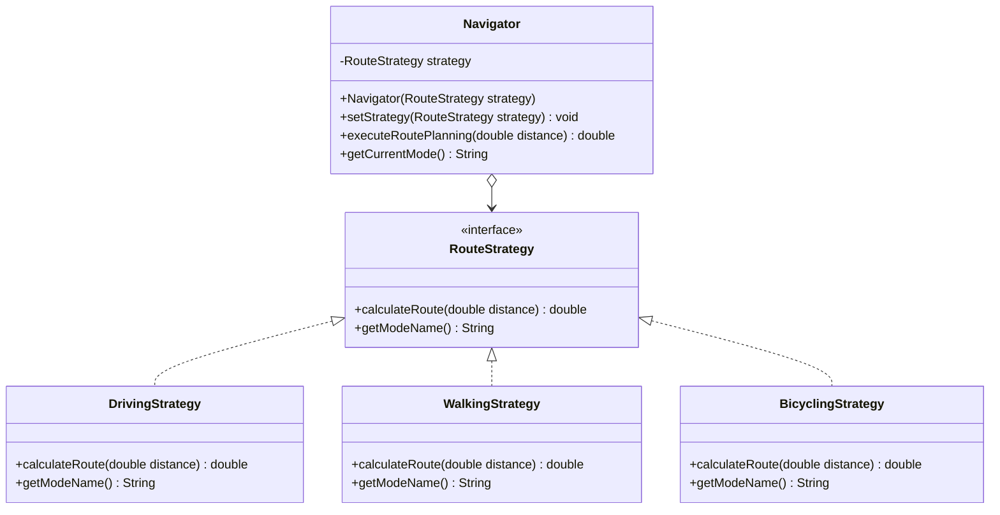

# Assignment 5: Strategy Pattern Implementation (Route Navigation System)

## 📌 Overview

This project is a practical implementation of the **Strategy** design pattern in Java for **Assignment #5 (Software Design Patterns)**.

The domain chosen for this project is a dynamic travel route and time calculation system (GPS Navigator). The application demonstrates how a navigation context can dynamically switch between different transportation routing algorithms (driving, walking, bicycling) at runtime without relying on conditional logic such as `if-else` or `switch` statements.

### Implemented Strategies:

* 🚗 **Driving**: `DrivingStrategy` — Calculates travel time based on vehicle speed limits (60 km/h).
* 🚲 **Bicycling**: `BicyclingStrategy` — Calculates travel time based on average cycling speed (15 km/h).
* 🚶 **Walking**: `WalkingStrategy` — Calculates travel time based on average pedestrian speed (5 km/h).

## 📐 Design Pattern Architecture

The **Strategy** pattern defines a family of algorithms, encapsulating each one, and making them interchangeable. It enables the algorithm to vary independently from clients that use it.

### Class Diagram (Mermaid)



## 🛠️ Project Structure

```text
.
├── RouteStrategy.java       # Strategy Interface
├── DrivingStrategy.java     # Concrete Strategy 1
├── WalkingStrategy.java     # Concrete Strategy 2
├── BicyclingStrategy.java   # Concrete Strategy 3
├── Navigator.java           # Context Class
└── Main.java                # Client / Entry Point
```

## 🧼 Adherence to Clean Code Principles

The implementation adheres to the guidelines from **Clean Code (Robert C. Martin, Chapter 10: "Classes")**:

1. **Elimination of Conditional Logic**
   Instead of using branching statements (`if-else` or `switch`) to select travel modes, the application uses polymorphism. The `Navigator` context invokes the uniform `calculateRoute()` method defined in the `RouteStrategy` interface.

2. **Single Responsibility Principle (SRP)**
   Each class has a single responsibility: `Navigator` manages the routing state and delegates calculation, while individual strategy classes (`DrivingStrategy`, `WalkingStrategy`, `BicyclingStrategy`) encapsulate only their respective calculation logic.

3. **Open/Closed Principle (OCP)**
   The system is open for extension but closed for modification. Adding a new travel mode (e.g., public transit or electric scooter) simply requires creating a new class that implements `RouteStrategy` without modifying existing context code.

4. **Context Algorithm-Agnosticity (Low Coupling)**
   `Navigator` is completely decoupled from concrete algorithm implementation details. It interacts solely with the abstract `RouteStrategy` interface.

5. **Self-Documenting & Meaningful Names**
   Class, method, and variable names clearly convey their intent, eliminating the need for redundant code comments.

## 🚀 How to Run

1. Clone or download this repository.
2. Compile all source files using Java CLI or open the project in any Java IDE (e.g., IntelliJ IDEA, Eclipse, VS Code).
3. Ensure **JDK 8** or higher is installed and configured.
4. Run `Main.java`.

### Command Line Execution:

```bash
javac *.java
java Main
```

### Example Console Output:

```text
Mode: Driving
Estimated Time: 12.5 minutes
Mode: Bicycling
Estimated Time: 50.0 minutes
Mode: Walking
Estimated Time: 150.0 minutes
```

---
*Assignment #5 — Software Design Patterns*