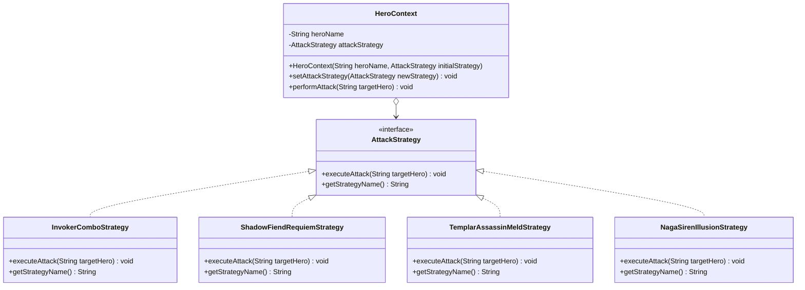

# Assignment 5: Strategy Pattern Implementation (Dota 2 Hero Battle System)

## Murodyan Mansur SE-2513

## 📌 Overview

This project is a practical implementation of the **Strategy** design pattern in Java for **Assignment #5 (Software Design Patterns)**.

The domain chosen for this project is a dynamic battle/attack style selection system for characters in **Dota 2**. The application demonstrates how a hero's strategy/behavior can be swapped dynamically at runtime without relying on conditional logic such as `if-else` or `switch` statements.

### Implemented Heroes & Attack Strategies:

* 🔮 **Invoker**: `InvokerComboStrategy` — Spell burst combo utilizing sphere combinations (Tornado + Chaos Meteor + EMP).
* 💀 **Shadow Fiend**: `ShadowFiendRequiemStrategy` — Soul-stacking physical damage combined with a channel burst of *Requiem of Souls*.
* ⚔️ **Templar Assassin**: `TemplarAssassinMeldStrategy` — Armor-reducing stealth critical strike executed via *Meld* and *Refraction*.
* 🐍 **Naga Siren**: `NagaSirenIllusionStrategy` — Multi-target illusion split (*Mirror Image*), target lock (*Ensnare*), and area surrounding with *Rip Tide*.

## 📐 Design Pattern Architecture

The **Strategy** pattern defines a family of algorithms, encapsulating each one, and making them interchangeable. It enables the algorithm to vary independently from clients that use it.

### Class Diagram (Mermaid)



## 🛠️ Project Structure

```text
src/
└── dota2/
    ├── Main.java                        # Client / Application entry point
    ├── context/
    │   └── HeroContext.java             # Context managing strategies
    └── strategy/
        ├── AttackStrategy.java          # Common Strategy interface
        └── impl/
            ├── InvokerComboStrategy.java        # Concrete Strategy for Invoker
            ├── ShadowFiendRequiemStrategy.java  # Concrete Strategy for Shadow Fiend
            ├── TemplarAssassinMeldStrategy.java # Concrete Strategy for Templar Assassin
            └── NagaSirenIllusionStrategy.java   # Concrete Strategy for Naga Siren
```

## 🧼 Adherence to Clean Code Principles

The implementation adheres to the guidelines from **Clean Code (Robert C. Martin, Chapter 10: "Classes")**:

1. **Elimination of Conditional Logic**
   Instead of using branching statements (`if-else` or `switch`) to select attack types, the application uses polymorphism. The context invokes the uniform `executeAttack()` method defined in the strategy interface.

2. **Single Responsibility Principle (SRP)**
   Each class has a single responsibility: `HeroContext` manages hero state and delegation, while individual `*Strategy` classes encapsulate only their respective attack logic.

3. **Open/Closed Principle (OCP)**
   The system is open for extension but closed for modification. Adding a new hero style simply requires creating a new class that implements `AttackStrategy` without modifying existing context code.

4. **Context Algorithm-Agnosticity (Low Coupling)**
   `HeroContext` is completely decoupled from concrete attack details. It interacts solely with the abstract `AttackStrategy` interface.

5. **Self-Documenting & Meaningful Names**
   Class, method, and variable names clearly convey their intent, eliminating the need for redundant code comments.

## 🚀 How to Run

1. Clone or download this repository.
2. Open the project in any Java IDE (e.g., IntelliJ IDEA, Eclipse, VS Code).
3. Ensure **JDK 8** or higher is installed and configured.
4. Run `src/dota2/Main.java`.

### Example Console Output:

```text
=== DOTA 2 BATTLE STRATEGY DEMO ===

[Invoker enters combat]: [Invoker Strategy] Spheres: Quas-Wex-Exort -> Cast Tornado + EMP + Meteor + Chaos Meteor on Roshan!

>>> Invoker changes fighting style to: [Shadow Fiend Requiem Burst]
[Invoker enters combat]: [Shadow Fiend Strategy] Soul Collection (Necromastery) + Blink Dagger + Requiem of Souls directly into Enemy Carry!

>>> Invoker changes fighting style to: [Templar Assassin Meld Strike]
[Invoker enters combat]: [Templar Assassin Strategy] Activate Refraction -> Meld Invisibility -> Armor-reducing critical strike on Pudge!

>>> Invoker changes fighting style to: [Naga Siren Illusion Split & Ensnare]
[Invoker enters combat]: [Naga Siren Strategy] Mirror Image (illusion split) + Ensnare (net lock) -> Surround target with Rip Tide on Storm Spirit!
```

---
*Assignment #5 — Software Design Patterns*